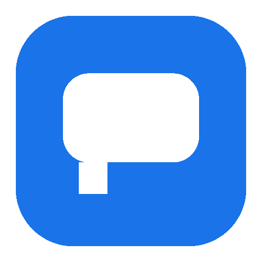

<div align="center">


# ChatDesk

**Google Chat in an app window, not a browser tab.**

A tiny native shell around [chat.google.com](https://chat.google.com) for
**Windows, Linux and macOS** — Rust · [tao](https://docs.rs/tao) · [wry](https://docs.rs/wry).

[](https://github.com/virusdeflect21/ChatDesk/releases/latest)
[](CHANGELOG.md)
[](LICENSE)
[](#system-requirements)
[](https://www.rust-lang.org)

*A ~0.7 MB executable that turns Google Chat's web client into a proper desktop app: tray icon, unread badge, notifications, launch-at-login, window memory, zoom — and a fraction of the RAM and CPU of a browser tab.*

</div>

---

> **Unofficial.** Not affiliated with, endorsed by or supported by Google. "Google Chat" is a trademark of Google LLC.

## Screenshots

| | |
|---|---|
| App icon |  |
| Tray with unread badge |  (on Windows the red circle carries the live unread count) |

The tray menu in full:

```
Show Google Chat
────────────────
Back
Forward
Reload
Back to Chat
────────────────
Zoom in
Zoom out
Actual size
────────────────
✓ Start with Windows
   Start hidden in tray
────────────────
Check for updates
Reset app data
Open in default browser
────────────────
Quit ChatDesk
```

## Why ChatDesk

Google killed the official Chat desktop app and pushes a browser PWA. ChatDesk gives you the web client you already use — same login, same features, works with consumer `@gmail.com` and Google Workspace accounts — but in its own window that lives in your tray, not in a Chrome tab eating 700 MB.

No setup: no Google Cloud project, no OAuth client, no API keys, and no Google Chat API — it loads exactly the web client your browser would, so nothing is workspace-only. Just sign in.

**Your login survives updates and reinstalls.** The session lives in the app's data directory, not next to the executable — download a new ChatDesk build, put it anywhere, run it: you are still signed in. Want a clean slate instead? Tray → **Reset app data**.

## Features

### New in v0.2.1
- **Linux and macOS builds** — the same app now ships for Windows, Linux (X11, webkit2gtk) and macOS (WKWebView); autoboot works everywhere (`Run` key on Windows, `~/.config/autostart` on Linux, LaunchAgent on macOS).
- **Links always open in your browser** — a plain click is enough (no modifier key): anything that isn't Chat itself — Docs, Drive, Meet, Calendar, external sites — hands off to your default browser instead of being silently blocked.
- **Unread counter on the Windows tray icon** — a red badge circle with the actual number of unread messages (up to 99), like other messengers; the tooltip shows the exact count too.
- **Even less RAM** — V8 heap cap 128→96 MB, disk cache 16→8 MB, idle trims 20→15 s, hidden trims 30→20 s.
- **Off-screen window guard** — if a monitor was unplugged, the window resets to a visible position instead of restoring off-screen.

### v0.2.0
- **Start with Windows (autoboot)** — flip one switch in the tray menu and ChatDesk launches at login. Flip it again to turn it off.
- **Start hidden in tray** — optionally boot quietly to the tray instead of opening a window.
- **Remembers your window** — size, position and maximized state come back where you left them.
- **Zoom** — zoom in / out / actual size from the tray menu; the level persists between launches.
- **Back, Forward, Reload, Back to Chat** — navigation without ever leaving the Chat window.
- **Check for updates** and **Reset app data** (signs out, wipes the profile and restarts clean) right from the tray.
- **~50% lower RAM and CPU than v0.1.0** — see [Performance](#performance).

### Always been there
- **~0.7 MB executable** — the browser engine is the WebView2 runtime Windows already has; nothing is bundled.
- **Locked to Google Chat** — no new windows, no tabs, no wandering to other sites.
- **Lives in the tray** — close the window and messages keep arriving; a red tray badge, taskbar overlay and balloon notifications tell you what's new.
- **Isolated profile** — its own session under `%LOCALAPPDATA%`, separate from your browser, with capped caches.
- **Single instance** — launching it again focuses the window you already have.
- **Fast first paint** — inline splash frame in about half a second while the real client loads.
- **Links open in your browser** — Docs, Sheets, Drive and anything else shared in chat opens in your real browser. Only Chat stays in the window.

## Performance

ChatDesk treats RAM and CPU as the main feature. Compared with a plain browser tab with Google Chat open:

| | Browser tab | ChatDesk v0.1.0 | ChatDesk v0.2.0 |
|---|---|---|---|
| RAM, window open | ~400–700 MB | ~150–250 MB | **~90–150 MB** |
| RAM, hidden in tray | unchanged | ~100–150 MB | **~40–80 MB** (standby-trimmed) |
| RAM, deep sleep (`CHATDESK_WEB_DEEP_SLEEP=1`) | — | ~3 MB | ~3 MB |
| Background CPU | steady | low | **near zero** |

How v0.2.0 cuts it roughly in half again:

- **Intensive wake-up throttling enabled** — hidden-window JavaScript timers fire once per minute instead of constantly, dropping background CPU to almost nothing.
- **Heap caps halved** — the renderer's V8 heap is capped at 128 MB (was 256), with `--lite-mode` still on by default.
- **Twice as eager to give memory back** — idle cache trims now run after 20 s unfocused (was 45 s) and hidden working-set trims every 30 s (was 60 s); pages go to the standby list so other apps get the RAM.
- **Caches halved** — disk 16 MB, media 4 MB.

Advanced knobs: `CHATDESK_WEB_FULL_JIT=1` (full JS speed), `CHATDESK_WEB_SOFTWARE_RENDERING=1` (software raster), `CHATDESK_WEB_DEEP_SLEEP=1` (full engine teardown in tray).

## System requirements

| | Minimum |
|---|---|
| OS | Windows 10 (1803+) / 11 · Ubuntu 22.04+/Debian 12+ (X11, GTK 3 + webkit2gtk 4.1) · macOS 12+ (Apple silicon) |
| Runtime | Windows: [Evergreen WebView2 Runtime](https://developer.microsoft.com/microsoft-edge/webview2/) (preinstalled on most systems). Linux: `libwebkit2gtk-4.1-0`, `libgtk-3-0`, `libayatana-appindicator3-1`. macOS: none beyond the OS. |
| RAM | 4 GB (works comfortably in 2 GB) |
| Disk | ~10 MB app + ~100 MB profile |
| Network | Internet access to `chat.google.com` |

Nothing else. No .NET, no installer service, no admin rights.

## Install

### Download (recommended)

1. Grab the build for your OS from the **[latest release](https://github.com/virusdeflect21/ChatDesk/releases/latest)**:
   - **Windows** — `ChatDesk-vX.Y.Z-windows-x64.exe`. Put it anywhere (`%LOCALAPPDATA%\ChatDesk` is a nice home) and run it. The build is unsigned, so SmartScreen may show "Windows protected your PC" — click **More info → Run anyway**.
   - **Linux** — `ChatDesk-vX.Y.Z-linux-x64.tar.gz`. Unpack and run:
     ```bash
     tar -xzf ChatDesk-vX.Y.Z-linux-x64.tar.gz
     ./chatdesk-web
     ```
   - **macOS** — `ChatDesk-vX.Y.Z-macos-arm64.tar.gz`. Unpack and run:
     ```bash
     tar -xzf ChatDesk-vX.Y.Z-macos-arm64.tar.gz
     ./chatdesk-web
     ```
     Gatekeeper may warn about an unidentified developer: right-click the binary → **Open**.
2. Sign in with your Google account. Done — next launches go straight to Chat.

To enable **autoboot**, open the tray menu → **Start with Windows** (the same switch writes the platform-appropriate login entry on Linux and macOS). To have it boot quietly instead of opening a window, also tick **Start hidden in tray**.

### Uninstall

Just delete the binary. For a full wipe, also remove the data directory — `%LOCALAPPDATA%\ChatDeskWeb` (Windows), `~/.config/ChatDeskWeb` (Linux) or `~/Library/Application Support/ChatDeskWeb` (macOS). If you enabled autoboot, untick it first.

## Build from source

```powershell
git clone https://github.com/virusdeflect21/ChatDesk.git
cd ChatDesk
cargo build --release
.\target\release\chatdesk-web.exe
```

Requirements: the [Rust toolchain](https://rustup.rs). On Windows use the msvc toolchain; on Linux also install `pkg-config libwebkit2gtk-4.1-dev libgtk-3-dev libayatana-appindicator3-dev librsvg2-dev`. Or just `cargo run --release`.

## Troubleshooting

| Problem | Fix |
|---|---|
| "Microsoft Edge WebView2 could not start" | Install the [Evergreen WebView2 Runtime](https://developer.microsoft.com/microsoft-edge/webview2/). |
| Session wedged / wrong account signed in | Tray → **Reset app data**, or delete `%LOCALAPPDATA%\ChatDeskWeb\profile`. |
| Window restored off-screen | Should not happen anymore (v0.2.1 guards it); to reset geometry, delete the settings file in the data directory. |
| Autoboot didn't stick | Some machines (corporate policy) block per-user Run entries; add ChatDesk to Task Manager → Startup apps instead. |
| Chat feels slow under heavy load | Relaunch with `CHATDESK_WEB_FULL_JIT=1`. |

## License

[MIT](LICENSE). This project wraps Google Chat's public web client and does not use the Google Chat API.
